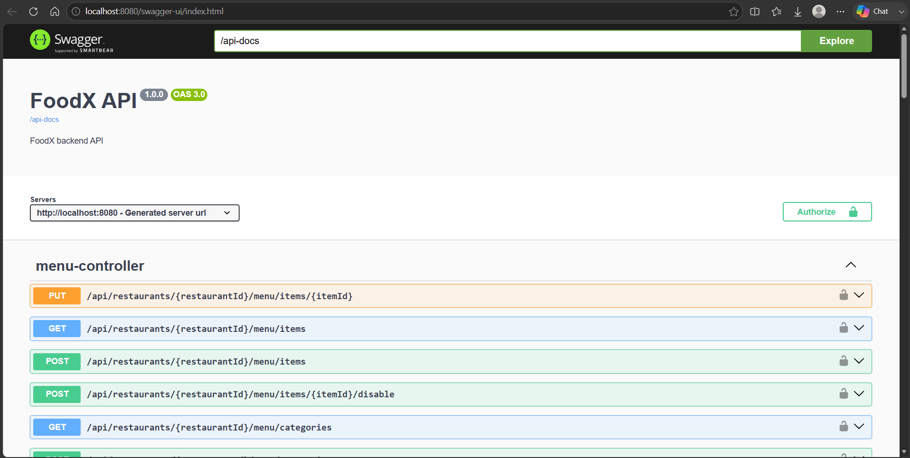
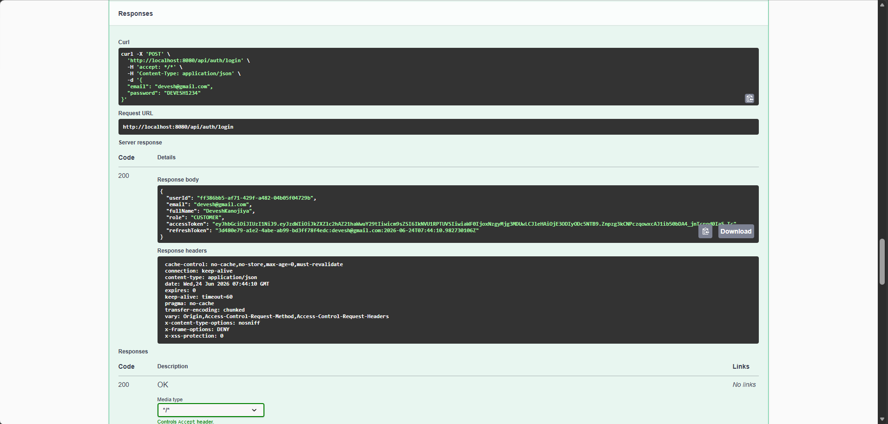
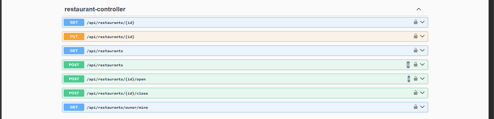
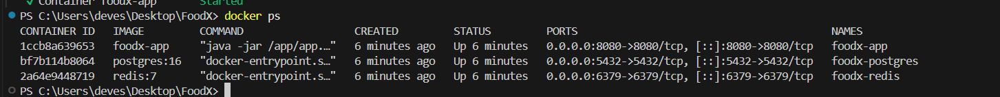

# FoodX

> **A production-style food delivery backend built with Spring Boot.**

FoodX is a backend application inspired by the core workflows of modern food delivery platforms such as **Swiggy** and **Zomato**. The project focuses on designing scalable REST APIs, secure authentication, caching, containerized deployment, and clean layered architecture using modern Java backend technologies.


---

# Features

## Authentication & Security

- User Registration & Login
- JWT Authentication
- Refresh Token Strategy
- Role-Based Authorization
- BCrypt Password Hashing
- Stateless Authentication

---

## Restaurant Management

- Create Restaurant
- Update Restaurant Information
- Open / Close Restaurant
- Disable Restaurant
- Search Restaurants

---

## Menu Management

- Create Menu Categories
- Add Menu Items
- Update Menu Items
- Enable / Disable Menu Items

---

## Cart Management

- Add Items to Cart
- Update Quantity
- Remove Items
- Clear Cart

---

## Order Management

- Place Orders
- Track Order Status
- Order History
- Order Status Updates

---

## Reviews

- Create Reviews
- Restaurant Review Management

---

## Performance

- Redis Integration
- Restaurant Details Caching
- Search Result Caching
- Automatic Cache Eviction

---

## API Documentation

- Swagger UI
- OpenAPI Documentation

---

## Deployment

- Dockerized Spring Boot Application
- PostgreSQL Container
- Redis Container
- Docker Compose Setup

---

# 🛠 Tech Stack

| Category         | Technologies           |
| ---------------- | ---------------------- |
| Language         | Java 21                |
| Framework        | Spring Boot 3          |
| Security         | Spring Security, JWT   |
| Database         | PostgreSQL             |
| Cache            | Redis                  |
| Documentation    | Swagger / OpenAPI      |
| Containerization | Docker, Docker Compose |
| Build Tool       | Maven                  |

---

# ⚙ Backend Concepts Implemented

- Layered Architecture
- RESTful API Design
- DTO Pattern
- JWT Access Tokens
- Refresh Token Strategy
- Role-Based Authorization
- Spring Security Filter Chain
- Global Exception Handling
- Redis Caching
- Stateless Authentication
- Dockerized Deployment

---

# Architecture

```text
                 Client
                    │
                    ▼
          Spring Boot REST API
                    │
       ┌────────────┴────────────┐
       ▼                         ▼
 Redis Cache             PostgreSQL Database
```

---

## Application Layers

```text
Controller
     │
     ▼
Service
     │
     ▼
Repository
     │
     ▼
Database
```

---

# Project Structure

```text
com.foodx
│
├── admin
├── auth
├── cart
├── common
├── config
├── exception
├── menu
├── order
├── restaurant
├── review
├── security
└── user
```

---

# Screenshots

## Swagger UI



---

## JWT Authentication



---

## Restaurant APIs



---

## Docker Containers



---

# Getting Started

## Clone Repository

```bash
git clone https://github.com/Deveshkanojiya/FoodX.git
cd FoodX
```

---

## Start Application

```bash
docker compose up -d
```

---

## Check Running Containers

```bash
docker ps
```

---

## View Logs

```bash
docker logs foodx-app
```

---

## Stop Application

```bash
docker compose down
```

---

# API Documentation

After starting the application, Swagger UI is available at:

```text
http://localhost:8080/swagger-ui/index.html
```

---

# Production Considerations

This project is intended for learning and portfolio purposes.

A production deployment would typically include:

- Unit & Integration Testing
- Database Versioning using Flyway
- CI/CD Pipeline
- Cloud Deployment (AWS)
- Secret Management using Environment Variables
- Rate Limiting
- Monitoring & Logging
- Email Notifications
- Centralized Configuration

---

# Roadmap

- [ ] Unit Testing (JUnit + Mockito)
- [ ] Integration Testing
- [ ] Flyway Database Migrations
- [ ] Pagination & Sorting
- [ ] Redis-based Rate Limiting
- [ ] GitHub Actions CI/CD
- [ ] AWS Deployment
- [ ] Email Notifications

---

# Author

**Devesh Kanojiya**

GitHub:
https://github.com/Deveshkanojiya

If you found this project helpful, consider giving it a ⭐.
